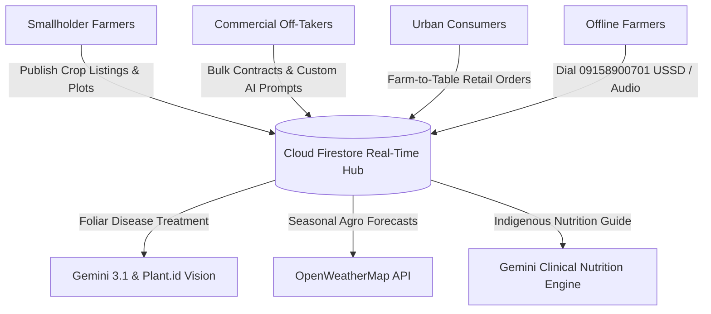

# LetsFarm — Next-Generation Agricultural Market Access & Telemetry Ecosystem

[-black?style=for-the-badge&logo=next.js)](https://nextjs.org/)
[](https://www.typescriptlang.org/)
[](https://tailwindcss.com/)
[](https://ai.google.dev/)
[](https://firebase.google.com/)
[](https://plant.id/)

> **A 3-Sided AgriTech Platform connecting Smallholder Farmers, Bulk Commercial Off-Takers, and Urban Consumers across Plateau State, Nigeria — powered by Gemini AI telemetry, computer vision diagnostics, and an offline USSD gateway.**

---

## 1. Executive Summary & Problem Statement

In sub-Saharan Africa, and specifically across Nigeria's agricultural food basket in Plateau State (Jos, Bokkos, Mangu, Barkin Ladi, Vom):

1. **Severe Post-Harvest Losses & Middleman Exploitation:** Smallholder farmers lose up to 40% of their harvested yield due to fragmented supply chains, opaque commodity pricing, and reliance on predatory middlemen.
2. **Commercial Procurement Friction:** Food processors, millers, and bulk off-takers struggle to contract reliable tonnage with verified moisture content and quality grades ahead of harvest.
3. **Food Inflation for Urban Households:** Urban consumers face 30% to 50% price inflation on everyday staples (Irish potatoes, maize, cabbage, cassava, fonio) through traditional multi-tiered distribution loops.
4. **Rural Connectivity Divide:** Over 60% of smallholder farmers operate in low-bandwidth or offline rural corridors without access to agronomic guidance or real-time commodity boards.

### The LetsFarm Solution
**LetsFarm** eliminates the middleman bottleneck through an interconnected platform with strict **Role-Based Access Control (RBAC)** that unifies three distinct user personas while providing an offline telecom bridge:



---

## 2. Platform Architecture & Core Portals

The platform isolates and customizes the entire dashboard experience according to the user's registered role:

### 🌾 1. The Farmer Portal (`/dashboard`)
Designed specifically for smallholders and farming cooperative clusters:
- **Zero Mock Data Overview:** Real-time metrics showing total registered farm hectares, active parcel counts, active marketplace inventory valuation, and live buyer purchase offers.
- **AI Botanical Crop Scanner (`/dashboard/crop-scanner`):** Instant camera/upload scan of diseased leaves. Calls the Kindwise `Plant.id v3` health API (quota-protected with one-call caching), analyzed by **Google Gemini 3.1** to generate a 3-part localized Nigerian treatment protocol (Immediate Action, Local Organic Remedies like neem slurry, and standard agro-inputs like Mancozeb/Ridomil Gold).
- **Cadastral GIS Asset Registry (`/dashboard/farm-details`):** Interactive satellite map visualizing farmer land boundaries with live area (Ha) calculation, parcel registry, and profile sharing.
- **Hyperlocal Agro-Weather & Seasonal Insights (`/dashboard/seasonal-insights`):** Integrated OpenWeatherMap API for Jos Plateau coordinates with 7-day outlooks and Gemini-generated soil moisture/irrigation advice.
- **Buyer Inquiry Negotiation:** Accept or decline direct purchase offers from verified off-takers with instant legal agreement previews.

---

### 🏭 2. The Off-Taker & Commercial Buyer Portal (`/dashboard/offtaker`)
Engineered according to the **Multi-Page PRD v3.0 Specification** for food processors, grain millers, and supermarket retailers:
- **Procurement Overview (`/dashboard/offtaker`):** Tracks total metric tons delivered, active in-transit shipments, and real-time status of sent supplier inquiries.
- **Produce Discovery Grid (`/dashboard/offtaker/marketplace`):** 3-column discovery feed with crop maturity windows (`Matured & Ready for Pickup` vs `Expected Harvest Window`), farm gate provenance, and an expandable procurement viewport with dual actions: *Submit Inquiry* and *Send Direct Escrow Payment*.
- **Orders Tracker (`/dashboard/offtaker/orders`):** Visual order cards featuring an interactive **Harvest Timing Toggle** (*When Harvested* vs *When Harvest Is To Be Done*).
- **AI Custom Sourcing Tool (`/dashboard/offtaker/custom-orders`):** Off-takers enter natural language bulk requirements (e.g. *"I need 10 metric tons of clean dry white maize delivered to Jos North by next Friday in 50kg sacks"*). **Google Gemini 3.1** parses tonnage, packaging, and delivery window, benchmarks fair regional market prices per ton (NGN), and broadcasts the specification to selected regional farmer clusters.
- **Purchased Inventory Ledger (`/dashboard/offtaker/inventory`):** Multi-attribute warehouse ledger filterable by Date, Harvest Stage (Pre-Harvest vs Post-Harvest), Crop Type, and Plateau LGA.

---

### 🥗 3. The Consumer Portal (`/dashboard/consumer`)
Direct farm-to-table shopping for individuals and households:
- **Household Pantry Overview (`/dashboard/consumer`):** Tracks household produce orders, estimated savings index (~28% below open retail market), and dietary quality score.
- **Direct Farm Store (`/dashboard/consumer/marketplace`):** Purchase staples in household units (Mudu & Kilograms) with direct checkout saving real orders to Firestore.
- **AI Nutritional Guide & Dietitian (`/dashboard/consumer/nutrition`):** Powered by **Google Gemini 3.1**. Consumers search indigenous Plateau and Nigerian crops (Fonio/Acha, Nicola Irish Potatoes, Cabbage, Bio-fortified Cassava, Soybeans) to receive:
  - Exact caloric & macronutrient density (Energy kcal, Protein, Carbs, Dietary Fiber, Glycemic Index).
  - Key micronutrients and targeted clinical wellness benefits (blood pressure, diabetes, gut health).
  - Authentic, step-by-step healthy Nigerian traditional recipes with companion market pairings.
- **Household Delivery Tracker (`/dashboard/consumer/orders`):** Track delivery status from farm gate to doorstep.

---

### 📱 4. Zero-Data USSD & Telecom Gateway
- For rural farmers without smartphones or data subscriptions, the platform integrates an interactive USSD/SMS flow accessible via **`09158900701`**, enabling produce price queries and crop disease SMS reports directly from feature phones.

---

## 3. Technology Stack

| Layer | Technology | Purpose |
|---|---|---|
| **Frontend Framework** | **Next.js 14.2 (App Router)** | Server & Client Components, Dynamic Route Handlers |
| **Language** | **TypeScript 5.0** | End-to-end type safety across schemas & APIs |
| **Styling & UI** | **Tailwind CSS 3.4 + Lucide React** | Responsive design, glassmorphism, responsive curved viewport geometry |
| **Database & Auth** | **Firebase Auth & Cloud Firestore** | Secure Email/Password auth, real-time NoSQL collections (`listings`, `orders`, `inquiries`, `plots`, `scans`) |
| **Generative AI** | **Google Gemini 3.1 Flash / 3.5 Flash** | Clinical nutrition engine, bulk sourcing NLP parser, localized agronomy treatments |
| **Computer Vision** | **Plant.id (Kindwise API v3)** | Foliar crop disease identification from leaf photographs |
| **Weather Telemetry** | **OpenWeatherMap API** | Live Plateau State temperature, humidity, rainfall forecasts |

---

## 4. Database Schema (Cloud Firestore)

```typescript
// Core Data Models
interface UserProfile {
  uid: string;
  accountType: "farmer" | "off-taker" | "consumer";
  fullName?: string;
  companyName?: string;
  email: string;
  phone: string;
  location: string;
  verified: boolean;
}

interface ProduceListing {
  id: string;
  farmerId: string;
  farmerName: string;
  crop: string;
  volumeMudu: number;
  volumeKg: number;
  pricePerMudu: number;
  grade: string;
  stage: "Ready Inventory" | "Expected Harvest";
  harvestDate?: string;
}

interface Order {
  id: string;
  buyerId: string;
  buyerType: "off-taker" | "consumer";
  sellerId: string;
  crop: string;
  quantity: number;
  unit: "tons" | "mudu" | "kg";
  totalPrice: number;
  stage: "pre-harvest" | "post-harvest";
  status: "Inquiry Pending" | "Payment Completed" | "In Transit" | "Delivered";
}
```

---

## 5. Local Setup & Installation

### Prerequisites
- **Node.js:** v18.17.0+ or v20+ (Node v22 verified)
- **Package Manager:** npm or yarn

### 1. Clone & Install Dependencies
```bash
git clone https://github.com/your-username/lets-farm.git
cd lets-farm
npm install
```

### 2. Configure Environment Variables
Create a `.env.local` file in the root directory:
```env
# Firebase Configuration
NEXT_PUBLIC_FIREBASE_API_KEY=your_firebase_api_key
NEXT_PUBLIC_FIREBASE_AUTH_DOMAIN=your_project.firebaseapp.com
NEXT_PUBLIC_FIREBASE_PROJECT_ID=your_project_id
NEXT_PUBLIC_FIREBASE_STORAGE_BUCKET=your_project.firebasestorage.app
NEXT_PUBLIC_FIREBASE_MESSAGING_SENDER_ID=your_sender_id
NEXT_PUBLIC_FIREBASE_APP_ID=your_app_id
NEXT_PUBLIC_FIREBASE_MEASUREMENT_ID=your_measurement_id

# AI & Weather Engine APIs (Server-Side)
GEMINI_API_KEY=your_google_gemini_api_key
PLANT_ID_API_KEY=your_plant_id_api_key
OPENWEATHER_API_KEY=your_open_weather_map_key
```

### 3. Run Development Server
```bash
npm run dev
```
Open [http://localhost:3000](http://localhost:3000) in your browser.

### 4. Build for Production
```bash
npm run build
npm run start
```
*Confirmed: Compiles 28 routes statically and dynamically with 0 TypeScript/ESLint errors.*

---

## 6. Hackathon Judging Matrix Alignment

- **Innovation & Technical Depth:** Real integration of Computer Vision (Plant.id) + Multi-Model AI (Gemini 3.1) with real-world failover and zero-data USSD fallback.
- **Authentic Localization:** Tailored specifically to Plateau State agriculture (Nicola potato varieties, dehulled Fonio/Acha, Mudu-to-kg conversion factors, Jos South aggregators).
- **Security & Role-Based Access Control:** Strict route guarding prevents consumers, farmers, and commercial buyers from accessing unauthorized operational views.
- **Economic & Social Impact:** Eliminates the middleman margin, protects smallholders via Escrow, and promotes indigenous food nutrition for families.

---

## 7. License & Acknowledgements
Built with ❤️ for Nigerian and African agriculture. Developed for the Let's Farm Agribusiness Hackathon.
